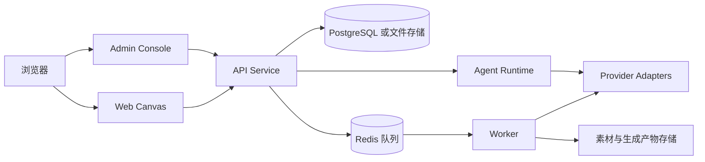

# Xinghuan Canvas

**Xinghuan Canvas（星幻无限画布 2.0）** 是一个面向 AI 创作与自动化工作流的节点式画布平台。用户可以在无限画布中组合模型、工具、素材和逻辑节点，运行可复用的工作流，并在资源库中管理输入素材与生成结果。

本文档面向首次了解项目的开发者、集成者和维护者，介绍产品能力、代码结构、本地运行方式和贡献约定。部署凭据、线上地址、迁移记录和内部运维台账不放在公开入口中。

## 能力概览

- **无限画布**：通过节点和连线表达输入、处理、模型调用、条件分支及输出关系。
- **多媒体创作**：支持文本、图片、视频、音频和大语言模型等节点类型，并统一展示任务状态与输出。
- **模型与 Provider 目录**：将供应商协议、模型条目、能力标签和路由策略分离，便于新增模型或替换退役模型。
- **工作流复用**：工作流可以保存、导出和共享；公共工作流引用的资源通过稳定的资源标识解析，而不是依赖某台机器上的临时路径。
- **资源库**：保存用户上传素材、工作流引用素材及生成产物，并按生命周期策略管理持久化和清理。
- **任务队列与 Worker**：将耗时的模型调用、媒体处理、轮询和压缩下载放到后台任务中，支持并发限制、重试和失败恢复。
- **管理后台**：提供 Provider、模型、权限、用户、任务、系统参数和运行状态的管理入口。
- **Agent Runtime**：为画布助手、知识快照、工具调用和受控自动化提供服务端运行时边界。
- **安全与审计**：包含会话鉴权、来源校验、CSRF 防护、权限隔离、敏感配置保护和任务链路观测。

## 架构总览



项目采用 npm workspaces 管理多个应用和共享包：前端负责交互，API 负责鉴权与业务编排，Worker 负责异步任务，Provider adapter 负责对接外部模型服务。开发环境可以使用文件存储；多人或生产环境建议使用 PostgreSQL、Redis 和独立的对象/文件存储。

## 仓库结构

```text
apps/
  web/                 画布与创作端（React + Vite）
  admin/               管理后台（React + Vite）
  api/                 HTTP API、鉴权、业务编排与持久化接口
  worker/              异步任务、模型调用、轮询和输出物料化
  comfyui-connector/   ComfyUI 连接器（按需启用）
packages/
  canvas-core/         画布领域模型与运行时基础能力
  agent-core/          Agent Runtime 与治理模型
  model-core/          Provider/模型目录及能力描述
  shared/              前后端共享类型、协议和媒体工具
  ui/                  通用 UI 组件与 Markdown 展示能力
config/                环境变量示例与本地配置模板
scripts/               构建、验证、迁移和发布辅助脚本
docs/                  架构、领域模型、系统说明和开发文档
```

## 环境要求

- Node.js 20 或更高版本
- npm（随 Node.js 一起安装）
- 可选：PostgreSQL 14+、Redis 6+
- 能访问所配置的模型 Provider（仅在实际调用模型时需要）

## 快速开始

### 1. 安装依赖

```bash
npm install
```

### 2. 创建本地配置

```bash
cp config/.env.example .env
```

Windows PowerShell 可以使用：

```powershell
Copy-Item config/.env.example .env
```

至少应修改以下配置：

```dotenv
XINGHUAN_APP_ENV=local
XINGHUAN_SECRET_KEY=请生成一个仅用于本地的随机密钥
XINGHUAN_BOOTSTRAP_ADMIN_PASSWORD=请设置本地管理员密码
```

`change-me` 仅是占位值，不能用于真实环境。Provider API Key、数据库连接串和共享 Token 应通过本地环境变量或受保护的部署配置注入，不能写入 Git 或提交到文档。

### 3. 构建并启动单端口服务

单端口模式会先构建 Web、Admin、API、Worker 及共享包，再由 API 服务统一提供访问入口：

```bash
npm run build:single-port
npm run start:single-port
```

默认地址为 `http://127.0.0.1:18200`。健康检查：

```text
http://127.0.0.1:18200/api/status
```

开发期间也可以分别启动各应用：

```bash
npm run dev:web
npm run dev:admin
npm run dev:api
npm run dev:worker
```

## 常用命令

### 质量检查

```bash
npm run type-check       # 所有 workspace 的 TypeScript 检查
npm test                 # Vitest 测试
npm run lint             # ESLint 检查
npm run build            # 完整构建
npm run ci               # 快速验证、构建和测试
```

### 领域与契约验证

仓库包含面向 API、画布、Provider、Worker、权限和发布流程的契约脚本。常用入口：

```bash
npm run verify:quick
npm run verify:single-port
npm run verify:canvas-workflow-capabilities-contract
npm run verify:provider-model-catalog-contract
npm run verify:worker
npm run verify:documentation-entry-contract
```

修改跨模块行为时，请同时运行相关的契约验证和单元测试；不要只依赖前端手工点击确认。

## 配置与 Provider

Provider 由三层信息组成：

1. **连接配置**：协议、基础地址、认证方式和超时策略。
2. **模型目录**：模型标识、显示名称、输入输出类型及能力标签。
3. **运行策略**：路由优先级、并发限制、重试/回退和可用范围。

新增 Provider 时，应优先复用 `packages/model-core` 与 `packages/shared` 中的类型和适配接口，再在 `apps/worker` 中接入异步执行。密钥只通过环境变量或后台的受保护配置保存；README、测试夹具和日志中不得出现真实密钥。

## 数据、资源与任务生命周期

- 工作流定义、节点参数和权限记录属于业务数据，应持久化到数据库或受控文件存储。
- 上传素材、公共工作流引用素材和生成产物使用稳定 ID 关联，避免依赖临时下载 URL 或开发机绝对路径。
- 任务由 API 创建、由 Redis 队列调度、由 Worker 执行，状态和输出通过 API 查询或事件更新。
- 生成产物的保留与清理遵循运行参数中的生命周期配置；清理任务不应删除仍被工作流或资源库引用的素材。
- 压缩包、缩略图等派生文件属于运行产物，构建和测试时不要把它们提交进源代码仓库。

## 安全边界

部署或二次开发时请遵循以下原则：

- 生产环境使用独立且随机的 `XINGHUAN_SECRET_KEY`、管理员密码和 Provider 密钥。
- 通过 HTTPS、可信来源校验、会话 Cookie 安全属性和 CSRF 防护保护浏览器请求。
- 按用户、工作区和资源所有权进行服务端授权；前端隐藏按钮不能替代 API 鉴权。
- 对公共工作流只共享工作流和明确授权的资源引用，不暴露其他用户的私有文件路径。
- 生产发布应使用构建后的、去除开发源码的制品；开发仓库仍保持可调试的源码结构。
- 日志、截图、Issue 和提交记录中不得包含 Token、Cookie、数据库 URL 或用户生成内容。

## 开发与贡献

1. 从最新开发分支创建主题分支，保持每次提交聚焦于一个可审查的改动。
2. 修改前先阅读相关系统文档和 `CONTEXT.md`，确认领域不变量与权限边界。
3. 为跨模块行为补充测试或契约验证，并运行至少 `npm run type-check`、相关测试和构建。
4. 同步更新受影响的系统文档；不要把服务器运维台账、迁移记录或内部地址写入根 README。
5. 提交前检查 `git diff`，确认没有运行产物、密钥、用户数据和本机绝对路径。

## 延伸阅读

- [领域语言与不变量](CONTEXT.md)
- [系统知识地图](docs/systems/README.md)
- [架构决策记录](docs/adr/README.md)
- [开发文档入口](docs/INDEX.md)

## 项目状态与授权

这是一个受项目所有者控制的内部/受限软件项目。仓库未声明任何开源许可证；代码使用权、部署权和再分发范围以项目所有者的书面授权为准。
