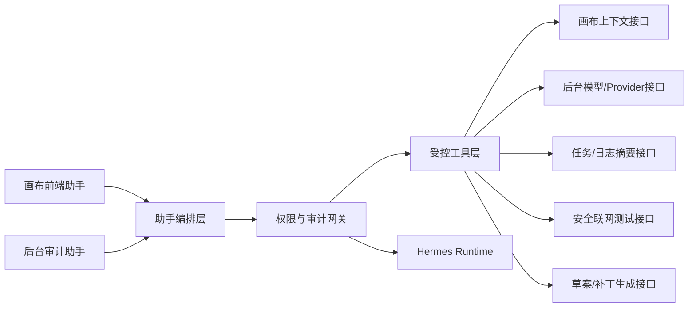

# 无限画布 AI 助手接入与实施方案

日期：`2026-06-08`

状态：`方案已确认 / 待进入实施排期`

## 1. 方案摘要

无限画布后续引入 AI 助手时，采用：

- 产品层自有
- 执行层可替换
- 当前阶段先接入项目专属隔离的 `Hermes runtime`

整体方案不是把 Hermes 直接嵌进现有站点，而是构建一套面向无限画布的受限助手体系：

1. 前端创作助手
2. 后台审计 / 配置助手
3. 项目内受控工具层
4. 项目专属 Hermes 执行内核

当前明确约束：

- 前端助手定位为创作副驾驶，不替代画布主交互
- 后台助手第一阶段只做“分析 + 草案生成 + 人工确认后应用”
- Hermes 不直接获得生产环境高权限
- 所有高风险动作保留人工确认闸门

## 2. 方案目标

本方案同时覆盖四类目标：

### 2.1 产品目标

- 在画布中提供真正可用的创作辅助，而不是普通聊天框
- 在后台提供可审计、可回溯、可控的接入与配置协助
- 保持当前项目产品完整性，不让 AI 助手变成第二套孤立系统

### 2.2 工程目标

- 复用 Hermes 的推理、工具编排、记忆与执行能力
- 避免将整个项目架构绑定为 Hermes 附庸
- 保证前端、后台、执行层边界清晰，可逐步演进

### 2.3 安全目标

- 不让助手直接改生产密钥、生产部署和核心系统配置
- 所有后台改动先进入草稿或 patch 待审区
- 对读取范围、联网行为、写入能力建立白名单和审计链

### 2.4 轻量化目标

- 默认以嵌入式助手形式工作，不引入过重平台
- 第一阶段优先复用现有画布、后台、任务和模型目录能力
- 只实现高价值链路，不提前做大而全自动化

## 3. 核心结论

当前确定采用的路线是：

### 3.1 产品形态

- 前端：`悬浮面板 + 可固定侧栏` 的创作助手
- 后台：`安全审计工作台 + 配置草案确认区`

### 3.2 架构形态

- 产品层在无限画布项目内实现
- 执行层抽象为可替换接口
- 当前执行内核先接 Hermes

### 3.3 权限形态

- 默认只读
- 可生成草案
- 不直接执行高风险改动

### 3.4 部署形态

- 使用项目专属 Hermes runtime
- 不直接复用当前服务器上的共享 Hermes 实例

## 4. 为什么采用这个方案

## 4.1 为什么不是“直接把当前 Hermes 接进来”

直接接入现有共享 Hermes 实例虽然最快，但存在明显问题：

- 记忆和上下文容易串线
- 工具权限很难收口
- 角色边界不清晰
- 审计和归责困难
- 后续拆分前台助手与后台助手会很混乱

因此不采用“共享 Hermes 直接挂载”的方式。

## 4.2 为什么不是“完全自建独立智能体平台”

完全自建虽然边界最清晰，但当前阶段成本过高：

- 需要重做 Hermes 已有的推理与编排能力
- 会拖慢当前画布主产品节奏
- 不符合轻量化推进目标

因此当前阶段也不采用完全重建。

## 4.3 为什么选择“方案 C + Hermes 内核”

这是当前投入产出比最合适的路线：

- 产品体验和权限边界由项目自己掌握
- Hermes 作为执行内核可快速提供成熟能力
- 后续若 Hermes 不合适，仍可替换内核而不重做前后台产品层

## 5. 总体架构

架构原则：

- UI 层只负责体验，不直接做高风险动作
- 助手编排层负责会话、上下文、权限判断和任务分派
- Hermes 只通过受控工具层接触项目能力
- 所有关键动作经过权限和审计网关

## 6. 模块拆分

## 6.1 前端创作助手

定位：`创作副驾驶`

面向对象：

- 登录后的普通画布用户

主要职责：

- 理解当前节点与工作流上下文
- 提示模型输入要求
- 推荐下一步节点或参数
- 协助 prompt 优化和失败原因解释

不承担的职责：

- 不修改后台 Provider 配置
- 不访问其他用户画布
- 不直接执行部署、数据库写入或系统命令

建议模块：

1. `assistant-launcher`
   - 右下角悬浮入口
   - 展示空闲、建议、分析中、报错提醒状态
2. `assistant-panel`
   - 默认浮窗态
   - 展示上下文摘要、快捷动作、对话区
3. `assistant-sidebar`
   - 固定态右侧助手栏
   - 适合长时间创作
4. `assistant-context-bridge`
   - 读取当前选中节点、模型能力、最近任务状态、工作流结构

## 6.2 后台审计 / 配置助手

定位：`安全审计工作台`

面向对象：

- 管理员

主要职责：

- 分析新 API 服务商和模型协议
- 生成 Provider / 模型配置草案
- 协助输出 `inputCapabilities`、`advancedConfig`、轮询参数等建议
- 联网分析 API 文档与安全测试结果
- 生成 adapter 草案和验收清单

不承担的职责：

- 不直接写生产密钥
- 不直接改系统服务
- 不直接部署到灰度或生产
- 不绕过管理员审批生效正式配置

建议模块：

1. `provider-analyzer`
2. `model-draft-generator`
3. `safe-api-test-runner`
4. `adapter-patch-draft-generator`
5. `approval-console`
6. `assistant-audit-log`

## 6.3 助手编排层

定位：`产品内助手中枢`

职责：

- 管理会话
- 组织上下文
- 选择工具
- 判断权限级别
- 调用 Hermes
- 汇总结果为用户可理解的建议或草案

建议由项目内单独模块承接，而不是散落在前端或后台页里。

## 6.4 受控工具层

定位：`Hermes 与项目系统之间的隔离边界`

所有 Hermes 工具调用都必须走这里。

首批建议工具：

- `get_canvas_context`
- `get_selected_node_context`
- `get_model_capabilities`
- `get_recent_task_failure_summary`
- `list_providers_and_models`
- `fetch_api_doc_page`
- `run_safe_api_probe`
- `generate_provider_draft`
- `generate_model_draft`
- `generate_adapter_patch_draft`
- `create_acceptance_checklist`

暂不开放：

- 任意 shell
- 任意文件写入
- 任意数据库直写
- 任意内部敏感接口 POST
- 任意部署控制能力

## 6.5 Hermes runtime

定位：`当前阶段执行内核`

运行要求：

- 项目专属实例
- 独立 memory
- 独立 config
- 独立 env
- 独立 logs
- 独立 API token
- 独立服务进程

建议不与当前服务器现有 Hermes 混跑。

## 7. 前端助手 UI 设计方案

参考方向：`Jaaz 的副驾驶式创作助手`

但不直接复制，需适配当前企业型画布产品。

### 7.1 默认形态

- 右下角悬浮入口
- 点击展开浮动面板
- 支持一键固定到右侧

这样能兼顾：

- 默认轻量
- 不遮挡大画布
- 需要时能进入深度辅助模式

### 7.2 面板结构

#### 顶部：上下文摘要

示例：

- 当前选中视频节点
- 模型支持首帧，不支持尾帧
- 最近一次任务失败原因是轮询超时

#### 中部：快捷动作

建议首批提供：

- 优化提示词
- 检查输入完整性
- 解释失败原因
- 推荐下一步节点

#### 底部：自然语言交互区

用户可以直接问：

- 这个模型为什么失败
- 我该补哪种输入
- 帮我整理成视频生成提示词

### 7.3 交互原则

- 助手优先围绕当前上下文回应
- 优先给“可操作建议”，而不是泛泛而谈
- 不强行抢主视图
- 允许用户忽略助手继续画布操作

## 8. 后台助手工作台设计

后台助手建议放在 `/admin` 下的独立页面或独立侧栏区域，保持工具型、可审计、可确认。

建议结构：

### 8.1 接入分析区

输入：

- 服务商文档链接
- 样例请求
- 样例响应
- 目标模型类别

输出：

- 协议类型判断
- 是否异步任务型
- 是否需要 adapter
- 推荐的配置层级

### 8.2 配置草案区

输出：

- Provider 草案
- 模型草案
- `inputCapabilities`
- `parameterSchema`
- `advancedConfig`
- `polling` 建议

### 8.3 联网测试区

允许执行：

- 文档抓取
- 安全探活
- 样例请求结构验证
- 响应路径提取
- 状态机识别

### 8.4 审批确认区

所有变更都先显示：

- 本次新增 / 修改内容
- 风险提示
- 草案 diff
- 应用范围

管理员确认后，才可写入后台草稿配置或生成 patch 待审核项。

## 9. 权限模型

建议采用四级动作模型。

### 9.1 L1 只读

自动允许：

- 读模型目录
- 读任务失败摘要
- 读画布上下文
- 抓取公开 API 文档
- 发起非破坏性测试请求

### 9.2 L2 草案生成

自动允许，但不直接生效：

- 生成 Provider 草案
- 生成模型草案
- 生成配置 JSON 草案
- 生成 adapter 草案
- 生成验收清单

### 9.3 L3 应用动作

必须人工确认：

- 写入后台草稿配置
- 创建待审核 patch
- 触发受限灰度预验收流程

### 9.4 L4 禁止动作

后台助手永不直接执行：

- 改生产密钥
- 改 Nginx / systemd
- 直接部署
- 批量删数据
- 直接修改正式环境核心配置
- 修改内部代理服务

## 10. 与当前项目能力的衔接方式

本方案必须与现有无限画布 2.0 基础能力顺滑衔接，而不是另起炉灶。

当前可复用能力：

- `/admin` 后台认证与管理框架
- Provider / 模型目录
- `inputProfile`、`parameterSchema`
- 结构化 `inputCapabilities` 方向
- 任务队列与 Worker
- 任务状态和失败摘要
- 灰度与生产双入口

第一阶段重点结合的现有能力：

1. 后台 Provider / 模型配置体系
2. 视频 / 图像异步 adapter 判断与草案生成
3. 画布节点上下文与模型能力读取
4. 管理员审批流

## 11. 轻量化设计原则

为避免助手能力把项目做重，后续实现必须坚持：

### 11.1 前台轻

- 默认不常驻大面板
- 不替代画布核心交互
- 不引入多余复杂编排 UI

### 11.2 后台轻

- 优先围绕“接入分析 + 草案 + 审批”
- 不做庞杂通用办公助手

### 11.3 服务轻

- 不独立建设大而全 AI 平台
- 先以内嵌模块接入当前 monorepo

### 11.4 自动化轻

- 第一阶段只做建议和草案
- 不提前做高风险自动落地

## 12. 执行路线

建议分五个阶段推进，每个阶段都有明确交付物和验收目标。

## Phase 0：方案冻结与边界确认

目标：

- 将本方案冻结为后续实施依据
- 补齐权限边界、工具白名单和部署边界

交付物：

- 本方案文档
- 权限矩阵
- 工具白名单初稿
- Hermes 专属 runtime 隔离约束

验收标准：

- 产品、工程、安全三方边界一致
- 明确第一阶段只做“生成草案 + 人工确认”

## Phase 1：前端助手壳

目标：

- 在画布页加入创作助手入口和基础上下文联动

交付物：

- 悬浮入口
- 浮动面板
- 可固定右侧助手栏
- 当前节点 / 模型 / 最近任务的上下文摘要

验收标准：

- 不破坏当前画布主交互
- 助手可围绕当前节点给出有效建议
- 在桌面端和移动端均无明显遮挡问题

## Phase 2：后台助手工作台

目标：

- 建立可用的接入分析与草案生成工作台

交付物：

- API 文档输入区
- 协议分析结果区
- Provider / 模型草案输出区
- 审批确认区

验收标准：

- 能针对至少一条新 Provider 样本产出完整草案
- 管理员可看见清晰 diff 和风险说明
- 所有结果保持草稿态，不直接生效

## Phase 3：Hermes 执行接入

目标：

- 将项目专属 Hermes runtime 接入助手编排层

交付物：

- Hermes runtime 部署模板
- 独立 env / config / memory / logs
- 工具白名单注册
- 会话和审计链路

验收标准：

- Hermes 只能调用白名单工具
- 同一请求的工具调用和输出可追踪
- 前后台助手可通过统一编排层使用 Hermes

## Phase 4：安全联网测试与配置草案联动

目标：

- 让后台助手能对目标 API 站点做受限联网分析

交付物：

- 文档抓取工具
- 探活工具
- 非破坏性请求验证工具
- 响应路径和轮询逻辑识别结果

验收标准：

- 至少覆盖一个同步协议样本
- 至少覆盖一个异步任务协议样本
- 输出能直接支撑 `advancedConfig` 或 adapter 草案

## Phase 5：受控落地与验收闭环

目标：

- 把“草案生成”与“人工确认应用”打通

交付物：

- 草稿写入接口
- patch 待审核产出
- 灰度预验收 checklist
- 审批日志

验收标准：

- 管理员可以确认一份草案并进入灰度验证
- 助手所有改动都有记录和回溯
- 仍不允许直接跳过审批写入正式环境

## 13. 验收路线

建议采用“三层验收”。

### 13.1 产品验收

- 前端助手是否真正提升创作流程可用性
- 后台助手是否真正减少接入分析成本
- UI 是否保持当前画布和后台的一致风格

### 13.2 工程验收

- 助手不破坏现有单端口、任务队列、后台模型治理
- 前后台集成不引入明显性能退化
- Hermes runtime 与项目主服务边界清晰

### 13.3 安全验收

- 白名单之外的工具不可被调用
- 高风险动作必须人工确认
- 所有联网测试与草案应用都有审计记录

## 14. 关键风险与应对

### 风险 1：Hermes 接入后服务变重

应对：

- 先限制为后台 / 助手专用执行内核
- 使用项目专属 runtime
- 首阶段只接必要工具

### 风险 2：助手越权

应对：

- 工具层白名单
- 审批流
- 禁止高风险动作直达

### 风险 3：前端助手变成噪音

应对：

- 默认轻量悬浮
- 强上下文驱动
- 先做可操作建议而不是泛聊天

### 风险 4：后台助手输出不可维护

应对：

- 草案结构化
- diff 可见
- 只允许受控字段
- adapter 草案与高级配置边界分明

## 15. 当前推荐实施顺序

若按投入产出比排序，建议：

1. 先落 Phase 0 文档冻结与边界确认
2. 再落 Phase 2 后台助手工作台最小版
3. 同步准备 Phase 3 Hermes runtime 隔离接入
4. 然后落 Phase 1 前端助手壳
5. 最后推进 Phase 4 与 Phase 5

原因：

- 当前最迫切价值在后台接入分析、模型草案和 API 测试
- 前端创作助手价值高，但依赖上下文和能力定义更稳定后体验更好
- 先把后台安全链路跑顺，后面前端助手也能复用同一编排层

## 16. 里程碑建议

### M1：助手边界冻结

- 文档确认
- 权限与工具边界确认

### M2：后台最小工作台上线灰度

- 能分析文档
- 能生成草案
- 能展示 diff

### M3：Hermes 受控接入完成

- 项目专属 runtime
- 审计链打通

### M4：前端创作助手上线灰度

- 悬浮面板
- 节点上下文联动

### M5：配置草案到灰度验收闭环打通

- 生成
- 审批
- 灰度验证
- 回溯记录

## 17. 最终结论

无限画布的 AI 助手不应被实现成：

- 一个普通聊天框
- 一个共享 Hermes 的外挂入口
- 一个拥有高权限的自动改站脚本

更合适的实现是：

- 前端做 Jaaz 风格的轻量创作副驾驶
- 后台做受限的接入分析与配置审计工作台
- Hermes 作为项目专属隔离执行内核接入
- 所有高风险动作通过工具白名单和人工审批闸门收口

这条路线能在保持当前项目轻量化和完整性的前提下，逐步把 AI 助手能力做成真正可持续的产品能力。
