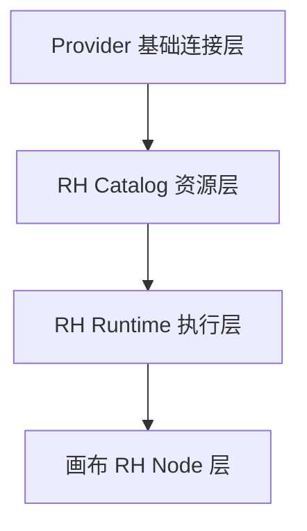
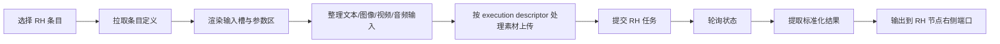

# RunningHub 接入与单节点改造方案

## 目标

本方案用于收口当前 RunningHub（以下简称 `RH`）在无限画布 2.0 中的后端接入、后台管理和前端节点设计，解决以下问题：

- RH 现在已经不只是普通 Provider 配置，而是带有“工作流 / AI 应用目录 + 字段映射 + 执行规则”的独立能力域。
- RH 当前虽然已有后台目录雏形，但仍是 `runninghub` 专用结构，没有形成稳定的后台管理面和统一执行描述。
- 画布上的 RH 节点仍偏技术态，尚未形成能同时适配文本、图像、视频、音频等输入输出的单一产品节点。
- 后续还会持续新增 RH 工作流 / AI 应用，如果继续把条目编辑塞在 Provider 大表单里，维护成本会持续上升。

本方案的最终目标是：

1. 保留 RH 独立标识，不做“去 RH 化”。
2. 后台将 RH 升级为独立业务管理面，但仍挂在 `runninghub` Provider 之下。
3. 前端只保留一个 RH 节点，通过后台下发的 schema 和 execution descriptor 动态变形。
4. RH 协议差异收口到后端运行时，而不是散落在前端节点中。

## 现状判断

当前 RH 并不是“纯前端硬编码节点”，而是已经具备了一层后台驱动雏形：

- Provider 记录支持 `protocol = runninghub`
- Provider 记录里维护：
  - `rhApps`
  - `rhWorkflows`
- 后端暴露：
  - `GET /api/runninghub/catalog`
- 前端 `RunningHubNode` 会：
  - 拉取 RH catalog
  - 选择工作流 / AI 应用预设
  - 渲染字段
  - 上传素材
  - 提交任务
  - 轮询结果

但当前结构仍存在三个明显问题：

1. RH 目录结构仍是 Provider 侧挂载字段，不是清晰的 RH 业务资源模型。
2. RH 条目编辑还是“长表单 + JSON 文本框”的工程视角，后台运营和接入维护成本高。
3. 前端 RH 节点虽然能跑，但尚未形成“单一 RH 节点 + 多类型输入输出”的稳定产品形态。

## 总体设计

本次 RH 改造采用四层结构：

1. `Provider 基础连接层`
2. `RH Catalog 资源层`
3. `RH Runtime 执行层`
4. `画布 RH Node 展示与运行层`



### 设计原则

- Provider 只负责“能否连上 RH”。
- RH Catalog 负责“我们在平台里登记和管理哪些 RH 工作流 / AI 应用”。
- RH Runtime 负责“素材如何上传、请求如何提交、状态如何轮询、结果如何提取”。
- RH Node 只负责“选择条目、采集输入、展示状态、输出结果”。

## 后端设计

### 1. Provider 层边界

`runninghub` Provider 继续保留以下职责：

- `baseUrl`
- `apiKey / auth headers`
- 连接测试
- 默认上传策略
- 默认轮询参数
- 健康状态摘要

Provider 页面不再承担 RH 工作流 / AI 应用的全量编辑职责，只保留：

- 基础连接配置
- RH 工作台入口
- RH 条目摘要

也就是说，Provider 页负责：

- “连不连得上 RH”

而不是：

- “RH 平台里的资源如何组织和投放”

### 2. RH Catalog 数据模型

当前 `rhApps` / `rhWorkflows` 保留兼容，但目标模型升级为：

```ts
type RhCatalogItemKind = "app" | "workflow";

interface RhCatalogItem {
  id: string;
  providerId: string;
  kind: RhCatalogItemKind;
  title: string;
  note?: string;
  thumbnail?: string;
  enabled: boolean;

  vendorAppId?: string;
  vendorWorkflowId?: string;
  runTargetId: string;

  capabilityTags: string[];
  inputSlots: RhInputSlotDefinition[];
  paramSchema: RhParamFieldDefinition[];
  outputSchema: RhOutputDefinition[];

  execution: RhExecutionDescriptor;

  workflowJson?: string;
  debugMeta?: Record<string, unknown>;
  visibility?: {
    adminOnly?: boolean;
    grayEnabled?: boolean;
    productionEnabled?: boolean;
  };
  version?: string;
  createdAt: string;
  updatedAt: string;
}
```

这个模型的重点是把 RH 条目从“几段 JSON 文本”升级为：

- 可管理的资源
- 有明确输入槽
- 有明确参数 schema
- 有明确输出定义
- 有明确执行规则

### 3. 输入槽模型

输入槽和参数字段必须拆开，避免节点把所有字段都变成画布端口。

```ts
interface RhInputSlotDefinition {
  key: string;
  label: string;
  description?: string;
  dataType: "text" | "image" | "video" | "audio" | "json";
  cardinality: "single" | "multiple";
  required: boolean;

  supportsConnection: boolean;
  supportsManualInput: boolean;
  supportsUpload: boolean;

  bindingTarget: {
    nodeId?: string;
    fieldName: string;
  };

  acceptRoles?: string[];
}
```

用途：

- 定义这个 RH 条目真正需要哪些输入
- 区分“可以接画布上游”与“只能手工填 / 上传”
- 支持多图、多视频、多音频输入

### 4. 参数字段模型

参数字段属于节点内部表单，不属于画布连线端口。

```ts
interface RhParamFieldDefinition {
  key: string;
  nodeId?: string;
  fieldName: string;
  label: string;
  description?: string;

  fieldType: "text" | "textarea" | "number" | "boolean" | "select" | "json";
  valueType?: "string" | "number" | "boolean" | "object";

  required?: boolean;
  defaultValue?: unknown;
  placeholder?: string;
  options?: Array<string | number>;

  bindable?: boolean;
}
```

适合表达：

- 分辨率
- 时长
- Seed
- 风格强度
- 模型变体
- 布尔开关
- 结构化 JSON 参数

### 5. 输出模型

```ts
interface RhOutputDefinition {
  key: string;
  label: string;
  dataType: "text" | "image" | "video" | "audio" | "json";
  cardinality: "single" | "multiple";
  resultPath?: string;
}
```

用途：

- 告诉前端 RH 节点应激活哪些输出口
- 明确返回单个结果还是多个结果
- 为多图、多视频的增量追加奠定基础

### 6. 执行描述模型

这是本方案里最关键的后端抽象。

```ts
interface RhExecutionDescriptor {
  submit: {
    endpoint?: string;
    method?: "GET" | "POST";
    bodyMode?: "json" | "form-data";
    requestBuilder?: string;
  };

  assetHandling: {
    mode: "url" | "fileName" | "multipart-file" | "upload-then-reference";
    uploadEndpoint?: string;
    uploadFieldName?: string;
  };

  polling: {
    enabled: boolean;
    endpoint?: string;
    intervalMs?: number;
    timeoutMs?: number;
    taskIdPath?: string;
    statusPath?: string;
    successValues?: string[];
    failureValues?: string[];
    failureMessagePath?: string;
  };

  result: {
    mode: "direct" | "polling";
    outputPaths: Array<{
      dataType: string;
      path: string;
      cardinality: "single" | "multiple";
    }>;
  };

  errorHandling: {
    providerErrorPath?: string;
    fallbackMessage?: string;
  };
}
```

作用：

- 把 RH 协议差异统一放到后端
- 前端节点不再理解 RH 平台的细节差异
- 后续不同 RH 工作流 / AI 应用即使提交、轮询、结果结构不同，也能走同一个 RH 节点

### 7. 后端接口设计

#### Provider 基础接口

- `GET /api/admin/providers`
- `POST /api/admin/providers`
- `PATCH /api/admin/providers/:id`

#### RH 管理接口

- `GET /api/admin/runninghub/items`
- `POST /api/admin/runninghub/items`
- `GET /api/admin/runninghub/items/:id`
- `PATCH /api/admin/runninghub/items/:id`
- `POST /api/admin/runninghub/items/:id/test`
- `POST /api/admin/runninghub/items/import`

#### 画布公开接口

- `GET /api/runninghub/catalog`
- `GET /api/runninghub/catalog/:id`
- `POST /api/proxy/runninghub/upload-asset`
- `POST /api/proxy/runninghub/submit`
- `POST /api/proxy/runninghub/query`

短期内允许继续保留现有 RH 接口形态，对外兼容；内部逐步改为读取新的 `RhCatalogItem` 模型。

## 后台管理页面设计

### 1. 页面位置

推荐结构：

- `后台 -> 服务提供商 -> RunningHub -> RH 工作台`

原因：

- RH 仍然依附于 `runninghub` Provider 的底层连接能力
- 但 RH 资源管理已经超出普通 Provider 表单的职责范围

因此不建议：

- 把 RH 全量管理继续塞在 Provider 大表单里

也不建议当前阶段直接做成完全独立一级页。

### 2. RH 工作台信息架构

页面顶部固定摘要区：

- 当前绑定 Provider
- baseUrl
- 协议与连接状态
- 条目总数
- 已启用数
- 最近测试状态
- 跳转 Provider 基础配置按钮

主体区使用 Tabs：

- `工作流`
- `AI 应用`
- `测试与调试`
- `草案导入`

### 3. 工作流 / AI 应用列表页

每条目显示：

- 标题
- 类型
- `runTargetId`
- 支持输入类型
- 输出类型
- 启用状态
- gray / production 可见性
- 最近测试结果
- 编辑入口

支持：

- 搜索
- 启用 / 停用
- 按输入类型筛选
- 按输出类型筛选
- 按工作流 / 应用筛选

### 4. 条目编辑页结构

建议分六个区：

1. 基础信息
   - 标题
   - 备注
   - 缩略图
   - 类型
   - vendor app / workflow id
   - `runTargetId`

2. 输入槽定义
   - 结构化表格编辑
   - 不以纯 JSON 文本框为默认入口

3. 参数 schema
   - 动态字段编辑器
   - 支持 select / textarea / boolean / json 等类型

4. 输出定义
   - 输出类型
   - 单结果 / 多结果
   - 结果字段路径

5. 执行描述
   - 上传规则
   - submit 规则
   - polling 规则
   - 错误提取规则
   - 超时设置

6. 调试区
   - 请求预览
   - 响应预览
   - 最近错误
   - 测试运行

### 5. RH 页中的 AI 助手

RH 页中的 AI 助手不再做“猜配置”，而是输出结构化接入草案。

输入可以是：

- RH 文档页链接
- RH 工作流详情页
- 示例请求 / 响应
- appId / workflowId

输出必须是：

- 基础信息草案
- 输入槽草案
- 参数 schema 草案
- 输出 schema 草案
- execution descriptor 草案
- 风险与待人工确认项

这一步只是辅助接入，不直接替代人工审核和保存。

## 前端单一 RH 节点方案

本次方案明确采用：

- 只保留一个 RH 节点

它的定义是：

- `RH Node = 资源选择器 + 动态输入槽 + 动态参数区 + 通用执行器 + 多类型输出器`

### 1. 节点布局

#### 顶部：资源选择区

显示：

- RH 标识
- 当前条目名称
- 类型：工作流 / AI 应用
- 能力标签：图像 / 视频 / 音频 / 文本
- 切换条目按钮
- 刷新 schema 按钮

#### 中部上半：输入槽区

每个输入槽一行：

- 名称
- 数据类型
- 是否必填
- 单个 / 多个
- 当前已接入数量
- 上传 / 手工填入入口（如果支持）

#### 中部下半：参数区

动态表单，完全由 `paramSchema` 驱动。

#### 底部：运行与状态区

显示：

- 执行按钮
- 当前状态
- 成功数 / 失败数 / 处理中数
- 最近错误摘要
- 输出结果摘要

### 2. 输入口设计

为了避免节点左侧长出大量 Handle，输入口采用“固定类型级”设计：

- `text-in`
- `image-in`
- `video-in`
- `audio-in`
- `json-in`

节点内部根据当前条目的 `inputSlots` 做映射。

例如某条目存在：

- 主图
- 参考图
- mask 图

则不直接在画布上长出三个图像 Handle，而是在节点内部输入槽区做映射：

- 主图槽位
- 参考图槽位
- mask 槽位

这样做的优点：

- 画布结构稳定
- 节点不会因为条目复杂度不同而发生巨大形态变化
- 同类型多槽位由节点内部处理，不让 React Flow 端口失控

### 3. 参数区设计

参数区只承载“节点内部配置”，不承担画布连线职责。

支持字段：

- text
- textarea
- number
- boolean
- select
- json

支持值来源：

- 手工填写
- 默认值
- 上游绑定（仅对可绑定字段）

### 4. 输出口设计

输出口同样采用固定类型级设计：

- `text-out`
- `image-out`
- `video-out`
- `audio-out`
- `json-out`

当前条目有对应输出时才激活。

多结果要求：

- 多图输出以数组形式保留
- 多视频输出以数组形式保留
- 新结果追加，不顶掉旧结果
- 下游素材 / 输出节点按追加方式消费

### 5. 运行状态展示

RH 节点状态展示要保持简洁，不做臃肿的大块任务列表。

默认仅展示：

- `进行中 N`
- `成功 N`
- `失败 N`

使用小字摘要即可。

当用户展开详情时，再查看：

- 子任务 `taskId`
- 任务状态
- 错误信息
- 最近返回摘要

## 执行数据流



关键原则：

- 前端不直接理解 RH 细节协议
- 上传、提交、轮询、结果、错误全部由后端 descriptor 驱动
- RH 节点负责采集输入、执行触发和结果展示

## 与当前实现的迁移方式

### Phase 1：后端模型与兼容层

- 保留现有 `rhApps` / `rhWorkflows`
- 在服务端新增 `RhCatalogItem` 规范化读法
- `/api/runninghub/catalog` 对外保持兼容
- 内部逐步切到 execution descriptor

### Phase 2：后台 RH 工作台上线

- 从 Provider 页抽出 RH 条目管理
- Provider 页保留基础连接配置与 RH 摘要入口
- RH 条目编辑切到结构化界面

### Phase 3：前端 RH 节点重做

- 新 RH 节点消费新的 RH catalog 条目结构
- 兼容旧节点数据：
  - `rhWorkflowPresetId`
  - `webappId`
  - `appInfo`
  - `nodeInfoList`
- 老画布打开时做自动映射

## 本次方案明确不做的内容

当前阶段不纳入：

1. ComfyUI 与 RH 的统一工作台合并
2. 所有外部平台统一为完全通用节点
3. RH 文档页的全自动抓取和全自动落配置
4. 多个 RH 专用节点并行设计
5. 去掉 JSON 高级编辑模式

本轮先把 RH 作为独立业务域收口清楚。

## 风险与注意事项

### 1. 素材上传规则差异

RH 不同工作流 / 应用对素材的要求可能不同：

- 直接传 URL
- 传 fileName
- 传 multipart file
- 先上传再引用

这些差异必须严格收口在 execution descriptor 里，不能继续散落在 RH Node 内部。

### 2. 结果结构差异

RH 不同条目的 query 结构可能不同，必须在后端做统一结果提取和错误提取。

### 3. 后台编辑复杂度

如果后台只保留 JSON 文本框，RH 工作台很快又会退回工程师专属页面，不适合持续运营维护。因此默认入口必须是结构化编辑器。

### 4. 旧画布兼容

已存在的 RH 节点数据不能因新模型直接失效，必须保留自动映射和兼容读取层。

## 结论

本方案的最终形态是：

- 后台保留 `runninghub` Provider 基础连接能力
- 后台新增 RH 工作台，统一管理工作流 / AI 应用目录
- 后端使用 `RhCatalogItem + execution descriptor` 承载 RH 条目定义
- 前端只保留一个 RH 节点，通过后台下发的输入槽、参数 schema、输出 schema 动态变形

这是当前阶段最稳的 RH 改造方向，既保留 RH 品牌和产品辨识度，也把后续持续接入 RH 新工作流 / AI 应用的成本压到可维护范围内。
