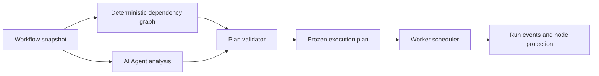

# AI Governance, Provider Operability And Supervision V2 Design

## Status

- Status: Approved for implementation by the user on 2026-07-24.
- Baseline: Gray `v0.7.42`.
- Scope: PC desktop only; visual acceptance at `1920x1080` and `2560x1440`.
- Release boundary: implementation, local verification and controlled external-model verification may proceed; Gray deployment remains paused until explicit approval. GitHub push and Production changes are forbidden.

## Problem

The current surfaces expose internal identifiers and protocol details where operators need human-readable ownership. Assistant governance is split between Provider configuration and Agent Runtime, while AI supervision has deterministic execution but no visible Agent analysis phase. RunningHub's Provider protocol only accepts specialized app/workflow payloads even when the configured model is a standard image or video endpoint. Supervision errors are partly translated, but they are not consistently actionable and the Canvas assistant receives only a narrow failure fragment.

This design treats the six requested UI/runtime changes and the supervision error/assistant follow-up as one operability program. They share the same rule: configuration, execution and diagnostics must use stable internal identities while presenting human-readable names and explanations to operators and members.

## Goals

1. Show Provider and model display names as the primary identity in Admin task monitoring while retaining raw IDs as secondary diagnostics.
2. Move assistant governance out of `Provider 与模型` and rebuild it under `智能体与自动化` with separate frontend and backend assistant controls.
3. Separate `AI 助手` governance from `AI 托管与自动化` governance without duplicating runtime configuration authority.
4. Make the Admin channel-health report visually bounded by Provider and model, using the member report's readable hierarchy.
5. Remove protocol badges from the compact Provider rail in the model catalog.
6. Support RunningHub standard image/video model endpoints through the generic Provider task system.
7. Add an AI Agent analysis phase before supervised execution, while preserving deterministic graph compilation and Worker authority.
8. Make supervision failures direct, specific and actionable in Canvas.
9. Let the Canvas assistant inspect the same normalized supervision failure envelope and help the user diagnose and repair the workflow.
10. Prove the assistant and supervision behavior with authenticated, real workflows and real model calls, not only source checks or mocked tests.

## Non-goals

- No mobile or tablet design work.
- No additional viewport matrix beyond `1920x1080` and `2560x1440`.
- No replacement of deterministic workflow compilation with free-form LLM scheduling.
- No direct assistant access to API keys, encrypted secrets, cookies or unrestricted task payloads.
- No automatic Production publication of Agent configurations.
- No migration of RunningHub app/workflow catalog entries into generic model records.
- No GitHub push and no Production deployment.

## Domain Boundaries

### Human-readable identity

Internal IDs remain authoritative for joins, permissions, idempotency and audit. Display names are presentation facts. Historical tasks need immutable name snapshots so later Provider renames or deletes do not make old task rows unreadable.

The task projection therefore exposes both:

```ts
interface TaskExecutionIdentity {
  providerId: string;
  providerName: string;
  modelRecordId: string;
  modelId: string;
  modelName: string;
}
```

For pre-migration rows, the read projection uses `snapshot -> live join -> raw ID -> 未知服务商/未知模型` fallback order. Filters continue to submit stable IDs.

### Assistant configuration authority

`AssistantSettings` owns surface behavior only: enabled state, title, placeholder and context attachment permissions. Agent Runtime owns model routing, system prompt, budget, approval and recovery policy through versioned drafts, review, approval and environment publication.

The new Admin experience composes these authorities in one workspace but does not merge them into a mutable monolith:

- Frontend Canvas assistant: surface settings plus `assistant-planner` Agent definition and its LLM route pool.
- Backend Admin assistant: surface settings plus a distinct `admin-assistant-planner` Agent definition and route pool.
- AI supervision and automation: environment controls, `supervision-planner`, candidate evaluator, generation recovery, quality policies, approvals, runs and audit.

The backend assistant does not inherit the frontend assistant's public-canvas knowledge profile. The frontend assistant does not receive Admin users, audit or Provider secret context.

### Supervision planning authority

AI Agent analysis is advisory and auditable. The deterministic compiler remains authoritative.



The Agent may explain concurrency opportunities, risks and recommended policies. It may not add nonexistent edges, remove dependencies, bypass port compatibility, exceed budgets or mutate the workflow. If the Agent is unavailable or its response fails validation, the run remains usable with deterministic analysis and a recorded `degraded` planning mode.

## Information Architecture

### Provider 与模型

Subpages:

- `服务商接入`: Provider name, endpoint, protocol, credentials and connection tests.
- `模型目录`: Provider rail and capability-grouped models.

The old `后台 AI 助手` subpage is removed from this workspace. Its legacy route redirects to the new assistant governance route.

The Provider rail shows icon, full Provider name, shortened base URL and enabled state. Protocol is available only in the Provider detail/editor and technical diagnostics. It is not rendered as a compact rail badge.

### 智能体与自动化

Top-level subpages:

- `AI 助手`
- `AI 托管与自动化`
- `运行与审计`

`AI 助手` uses a frontend/backend segmented control. Each segment exposes:

- surface enabled state and copy;
- permitted context attachments;
- bound Agent definition and published version per environment;
- LLM route pool and fallback order;
- prompt, knowledge profile, token budget and timeout;
- approval/read-only policy summary;
- draft, review, publish and rollback controls.

`AI 托管与自动化` exposes:

- environment switches;
- supervision planner Agent and model routing;
- maximum parallelism and queue policy;
- candidate selection and quality thresholds;
- failure recovery and approval policy;
- deterministic fallback behavior.

`运行与审计` exposes Workflow Runs, Agent Runs, approvals, failure diagnostics and immutable action audit.

## Task Monitoring Design

Admin task rows display:

- Provider column: `providerName` primary, short `providerId` secondary.
- Model column: `modelName` primary, provider model ID secondary.
- Tooltips contain full names and raw IDs.
- Provider filter labels use names but values remain IDs.

Task creation freezes `providerNameSnapshot`, `modelNameSnapshot` and `providerModelIdSnapshot` in a dedicated execution identity snapshot. Retry copies the original snapshot unless a new model is explicitly selected. Historical fallback must not require reading full task payloads in list queries.

## Channel Health Admin Design

The Admin report uses the shared semantic report component with an explicit `admin` presentation variant. Data semantics do not change.

Layout rules:

- Content is centered and capped to a readable desktop width.
- Each Provider is a bounded repeated panel with a visible header and aggregate state.
- Every model row has fixed identity, success-rate, 72-hour trend and feedback columns.
- Model rows have opaque backgrounds and full row separators.
- Provider and model names never share space with protocol identifiers.
- The report retains manual refresh, optional five-minute refresh, filters and stale-data banner.
- At `1920x1080` and `2560x1440`, columns remain aligned and text does not overlap or disappear.

## RunningHub Standard Model Protocol

RunningHub has two execution families that must remain explicit:

1. Specialized app/workflow execution: existing `webappId`, `workflowId`, `nodeInfoList` and RH catalog governance.
2. Standard model execution: a model-specific `/openapi/v2/<model-path>` endpoint with prompt/media parameters and `/openapi/v2/query` polling.

Generic Provider model records use the standard model family when no app/workflow run target exists and a provider model path is configured. The resolved execution mode is frozen in the task payload as `runningHubExecutionMode: "standard_model" | "catalog_target"`.

Standard request contract:

- Submit URL: normalized Provider base plus `/openapi/v2/<trimmed model path>`.
- Authentication: `Authorization: Bearer <key>`.
- Body: validated model parameters, prompt and media arrays without platform-added prompt truncation beyond the platform's global safety ceiling.
- Poll URL: normalized Provider base plus `/openapi/v2/query` with `{ taskId }`.
- Status mapping: `QUEUED`, `RUNNING`, `SUCCESS`, `FAILED` to the platform task lifecycle.
- Result mapping: `outputType` determines image, video, audio or text output.
- Artifact handling: successful temporary URLs are materialized into the owner-scoped artifact store before task completion.
- Diagnostics: persist status, safe upstream error code/message, task ID and adapter name; never persist API keys or full signed URLs in logs.

Reference media uses already-authorized platform URLs when RunningHub can fetch them. When it cannot, the adapter uploads the binary through `/openapi/v2/media/upload/binary` and submits the returned temporary URL. Media upload and generated output URLs are treated as one-day temporary resources.

## AI Agent Analysis And Concurrency

Planning produces two frozen artifacts:

```ts
interface CanvasRunAgentAnalysis {
  status: "succeeded" | "degraded" | "failed";
  summary: string;
  concurrencyGroups: Array<{
    id: string;
    stepIds: string[];
    reason: string;
  }>;
  serialConstraints: Array<{
    beforeStepId: string;
    afterStepId: string;
    reason: string;
  }>;
  risks: Array<{ code: string; message: string; nodeIds: string[] }>;
  recommendedMaxParallelism: number;
  agentRunId?: string;
}
```

```ts
interface CanvasRunExecutionLayer {
  index: number;
  stepIds: string[];
  maximumParallelism: number;
}
```

The compiler derives execution layers from actual dependencies. The Agent analysis can lower recommended parallelism or flag a risky group, but cannot place dependent steps in the same layer. Effective parallelism is the minimum of workflow setting, published policy, Provider quota and ready-step count.

Canvas presents planning as a visible state:

- `分析工作流`: Agent and deterministic compiler are building the plan.
- `计划已生成`: show parallel groups, serial constraints, risks and estimated request count.
- `等待确认`: only when policy requires user approval.
- `执行中`: show active layers and node-level task progress directly on the canvas.

## Error Contract And Assistant Context

All supervision failures are normalized into a shared, safe envelope:

```ts
interface CanvasRunFailureDiagnostic {
  code: string;
  category: "workflow" | "input" | "model" | "provider" | "queue" | "budget" | "permission" | "runtime" | "unknown";
  title: string;
  summary: string;
  action: string;
  retryable: boolean;
  runId?: string;
  stepId?: string;
  nodeId?: string;
  providerName?: string;
  modelName?: string;
  providerState?: string;
  occurredAt?: number;
  technical: { code: string; requestId?: string; upstreamHttpStatus?: number };
}
```

Canvas error copy follows four visible questions:

1. What failed?
2. Where did it fail?
3. Why did it fail in plain Chinese?
4. What can the user do now?

Raw codes, request IDs and HTTP status are collapsed under technical details. Secret-bearing payloads, signed URLs and full upstream responses are never exposed.

The Canvas assistant receives the normalized diagnostic, the failed step's sanitized configuration, bounded upstream/downstream node IDs, the frozen plan group/layer and the latest relevant events. A dedicated `分析此错误` action opens the assistant and attaches this context. The assistant must state evidence, uncertainty and repair steps; it must not claim that it retried or changed a workflow unless an audited action actually occurred.

## Verification Strategy

Every implementation phase has four gates:

1. Focused contract/unit tests proving deterministic behavior and safe projections.
2. Type-check and relevant application build.
3. Authenticated browser behavior at both approved PC viewports.
4. Evidence recorded in a validation logbook before the next phase begins.

Real AI verification is mandatory:

- Frontend assistant: ask it to explain a real failed supervision run using the attached normalized diagnostic.
- Backend assistant: confirm the separately published model/policy is used and Admin-only context boundaries are respected.
- AI supervision: run a workflow with at least two independent upstream branches, a convergence step and one generated failure; confirm real concurrency, visible node progress, clear error and assistant analysis.
- RunningHub image: one real standard image-model request through the generic Provider route.
- RunningHub video: one real standard video-model request using an allowed image input through the generic Provider route.
- Generated outputs must be materialized and remain accessible after the upstream temporary URL is no longer used by the UI.

Mocked tests remain required for status/error edge cases, but they do not satisfy these real verification requirements.

## Stage Gates

1. Planning gate: this design and implementation plan exist and pass self-review.
2. Identity/UI gate: task names, Provider rail and channel report pass focused tests and both PC viewport checks.
3. Governance gate: new IA and separate assistant configurations pass route, permission, draft/publish and visual checks.
4. RH gate: adapter tests pass, then controlled real image/video tasks succeed with stored outputs.
5. Supervision gate: Agent analysis, deterministic validation, concurrency and normalized failures pass tests and real workflow execution.
6. Assistant diagnostic gate: real assistant response uses the real failed-run diagnostic and gives evidence-based repair guidance.
7. Release gate: full Harness, diff review and documentation pass; stop before Gray deployment until explicit approval.

## Rollback

- UI routes keep legacy redirects so the governance IA can be reverted without breaking bookmarks.
- Task display snapshots are additive and old rows retain fallback projections.
- RunningHub standard-model routing is explicit in the frozen task payload; specialized app/workflow execution remains untouched.
- Agent analysis can be disabled by published policy, returning supervision to deterministic planning.
- Failure diagnostics are additive projections over existing run events and do not rewrite historical event payloads.
