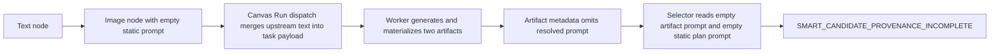
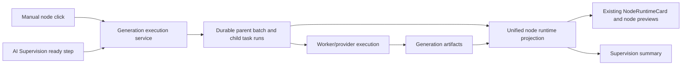

# AI Assistant And Supervision Runtime Usability Design

## Status

- Status: Approved for documentation and implementation planning by the user on 2026-07-25.
- Runtime baseline: Gray `v0.7.43`, release `20260725-ai-governance-supervision-gray-r1-v0743`.
- Source baseline: branch `feature/canvas-agent-runtime`, commit `d342ed3`.
- Production boundary: Production remains `v0.7.18` and must not be changed, restarted or used for testing.
- Release boundary: this document does not authorize GitHub push or Gray deployment. Implementation, local verification and authorized Gray testing require the normal stage gates; deployment requires a later explicit instruction.
- Visual boundary: PC desktop only. Run one visual acceptance at `1920x1080`; do not run a dual 1080p/2K matrix. Use 2K only when the user explicitly replaces the default viewport.

## Purpose

This document combines six previously analyzed problem tracks, including the direct-entry blank model selector, with four newly reported Gray defects into one execution batch. The common failure is not cosmetic: the current product exposes separate execution, presentation and diagnostic paths for operations that users experience as one AI-assisted workflow.

The target is a single maintainable runtime contract:

1. Manual node execution and AI-supervised execution use the same durable task, batch progress, output artifact and node rendering semantics.
2. AI Assistant and AI Supervision remain separate authorities, but their desktop panels coordinate geometry and never cover each other.
3. User-facing surfaces display human node identities and concise explanations; stable IDs and technical codes remain available only as secondary diagnostics.
4. Admin governance loads its own data, follows the established Admin visual system and exposes one focused workspace at a time.

## Evidence Reviewed

### User evidence

- Screenshot 1 shows a real Gray Workflow Run stopping at `smart-candidate-selector` with `SMART_CANDIDATE_PROVENANCE_INCOMPLETE:gen-task-...-image-1` after the upstream image node has produced results.
- Screenshot 2 shows the AI Supervision panel covering most of the AI Assistant panel. The assistant remains interactive but its content and composer are obstructed.
- Screenshot 3 shows serial constraints rendered as long raw node IDs, forcing one character per line inside the supervision panel.
- The user also reported blank model selectors in Admin Agent governance, Admin assistant visual/runtime divergence, Chinese IME truncation, transient text selection and AI-supervised nodes failing to show normal node progress and outputs.

### Code evidence

- `packages/agent-core/src/smart-candidate-selector.ts` rejects a candidate when `prompt`, `providerId`, `modelRecordId` or other provenance fields are empty.
- `apps/worker/src/canvas-run-candidate-selector.ts` reads the prompt from artifact metadata or the immutable plan's static execution payload.
- `apps/worker/src/canvas-run-coordinator.ts` resolves upstream text into the actual task payload only at dispatch time.
- `apps/worker/src/output-materials.ts` currently materializes artifacts with `dedupeKey` and `registrationSource`, but does not freeze the resolved prompt into artifact provenance.
- `apps/web/src/components/canvas-agent/canvas-run-node-projection.ts` projects only `{ status, label }`; it cannot drive normal runtime cards or output previews.
- `apps/web/src/components/Canvas.tsx` applies that projection only as a class and `aria-label`.
- `apps/web/src/components/canvas-assistant/assistant-geometry.ts` chooses the side with less overlap but does not compute a legal movement region that excludes the supervision panel.
- `apps/api/src/server.ts` tells the assistant to produce 3 to 6 structured sections and expose detailed facts, which encourages parameter-heavy answers even for ordinary user questions.
- `apps/admin/src/admin-data-loaders.ts` does not load the model catalog when the active workspace is `agent-runtime`; the editor therefore receives an empty model array on direct entry.
- `apps/admin/src/admin-assistant-panel.tsx` does not yet share the Canvas assistant's complete conversation/runtime behavior.
- `apps/web/src/components/nodes/MentionPromptInput.tsx` has IME composition guards, while the assistant composers do not consistently use the same protection.

## Integrated Problem Report

| ID | Severity | Problem | Confirmed cause or boundary | Expected result |
| --- | --- | --- | --- | --- |
| P1 | Critical | AI-supervised nodes do not show normal execution and outputs | Supervision emits a class-only node projection separate from normal node runtime data | Original image/video/audio/output nodes show the same task cards, batch progress, errors and media previews as manual execution |
| P2 | Critical | Smart selector stops on incomplete provenance | Resolved upstream prompt exists in the dispatched task but is not frozen into artifact provenance; selector falls back to the empty static node prompt | Two artifacts generated by one upstream node remain valid candidates and selection continues with auditable provenance |
| P3 | High | Supervision may submit or display generation counts differently from normal nodes | Supervision batches inside a Worker task while normal nodes maintain independent async task runs | Both entry paths use the same generation batch contract and expose every requested child run and result |
| P4 | High | AI Assistant and AI Supervision panels overlap | Assistant geometry compares two side candidates but does not subtract the supervision rectangle from its legal drag space | When supervision is open, assistant launcher and panel remain inside the non-overlapping desktop region; closing supervision restores full movement |
| P5 | High | Admin model selectors can be blank while Agent conversations still work | Published Agent routes are valid, but direct `agent-runtime` navigation skips model catalog loading | Agent workspace loads enabled chat models directly and never depends on visiting Provider pages first |
| P6 | High | Admin supervision configuration requires long vertical scrolling and uses inconsistent controls | Multiple task domains are rendered in one continuous workspace | Internal workspace tabs show one focused domain at a time using established Admin form and surface components |
| P7 | High | Admin assistant differs from Canvas assistant and lacks clear analysis state | The Admin panel has separate rendering/composer behavior and incomplete SSE status consumption | Shared assistant primitives provide the same message formats, paste behavior, process state and `正在分析` feedback while Admin-only context remains available |
| P8 | High | Chinese IME can be truncated and text selection can disappear after mouse-up | Assistant inputs lack the proven composition guard; some controlled rerenders and canvas pointer handlers may interfere with native selection | Composition commits only after `compositionend`; native selection survives mouse-up until the next intentional click or selection |
| P9 | Medium | AI answers are too parameterized and technically dense | Prompt policy defaults to multi-section technical documents; raw IDs are included in normal answers | Default answers lead with a short conclusion and concrete next action; codes, IDs and parameter detail appear only on explicit request or inside collapsed technical detail |
| P10 | Medium | Supervision panel is dense and long raw node IDs break layout | Summary, analysis, plan, events and diagnostics are stacked; Run snapshots contain no frozen human node identity | Default runtime view is concise, detailed plan/events are separate tabs, and every user-facing node reference uses a human label plus short stable suffix |

## Root Cause: Smart Candidate Provenance

The reported selector failure is not caused by having only one incoming edge. One image generation node configured for two outputs legitimately contributes two candidate artifacts through one edge. Candidate cardinality is based on artifact count, not edge count.

The actual sequence is:



The fix must not weaken provenance checks. It must preserve the final resolved execution facts:

```ts
interface GenerationExecutionProvenanceV1 {
  schemaVersion: 1;
  sourceTaskId: string;
  sourceNodeId: string;
  canvasRunId?: string;
  canvasRunStepId?: string;
  providerId: string;
  modelRecordId: string;
  resolvedPrompt: string;
}
```

New artifacts freeze this safe provenance at materialization time. Existing artifacts use an owner-scoped compatibility projection from `source_task_id` and the task's frozen payload. If neither source contains the required fact, the selector still fails closed, but the diagnostic names the missing field and the human node identity.

The selector acceptance case must match the user's real topology: one text node, one image node requesting two or three images, one AI selector and one downstream image node. Adding a second upstream image node is not required.

## Target Runtime Architecture

### One execution contract

AI Supervision owns only planning, dependencies, concurrency limits, pause/resume/cancel and governed selection. It must not own a second node runtime renderer or a second result model.



The unified projection includes:

```ts
interface NodeExecutionProjection {
  authority: "manual" | "workflow_run";
  runId?: string;
  runStepId?: string;
  status: "idle" | "queued" | "running" | "success" | "error" | "cancelled";
  progress: string;
  taskId?: string;
  taskRuns: TaskRunState[];
  startedAt?: number;
  finishedAt?: number;
  error?: string;
  outputs: {
    generationArtifactIds: string[];
    imageUrls: string[];
    videoUrls: string[];
    audioUrls: string[];
    text?: string;
  };
}
```

The projection is server-authoritative and transient. It is merged into rendered node props in memory and must never be persisted into Canvas topology JSON. Existing node components consume it through a shared adapter and continue using their current runtime card, preview, error and download UI.

### Batch semantics

- `generationCount = N` creates N independently observable child task runs under one logical node execution.
- Child submissions and result polling use the same concurrency policy for manual and supervised execution.
- Each child can complete or fail independently; progress updates after every child terminal state.
- Node success requires the batch's configured success policy. The default remains all requested children successful unless the existing model contract explicitly allows partial completion.
- Artifact order is stable by `batchIndex`, not response arrival time.
- Cancelling the Workflow Run cancels unfinished child runs and ignores late results without deleting completed artifacts.

## Human Node Identity

Stable IDs remain authoritative for storage, joins, ownership and audit. They stop being the primary user-facing label.

The common display format is:

```text
<custom node name or catalog name> #<stable ID suffix>
```

Examples:

- `人物生成 #v3uy`
- `智能候选选择器 #ydhc`
- `角色入座写真 #0jk4`

Resolution order:

1. `data.label`, `data.name` or `data.title` after trimming.
2. Node Capability Catalog label for the node type.
3. `未知节点`.

The suffix is the final non-empty token after `-`, limited to eight safe alphanumeric characters. For short legacy IDs such as `image-2`, the suffix is `2`. Raw IDs appear only in technical details and audit exports.

The compiler freezes this display identity in each Run step so historical runs do not change when the Canvas node is renamed later. The same helper is used by supervision readiness, plan steps, AI analysis, failure cards, candidate UI, assistant attachments and user-facing event detail.

## Desktop Panel Coordination

The supervision panel remains a right-side fixed workbench. While it is open, its measured rectangle plus a 12px safety gap becomes an obstacle.

Assistant geometry must:

1. Subtract the obstacle from the desktop viewport and compute legal rectangles for the assistant panel and launcher.
2. Choose the legal rectangle closest to the stored assistant anchor.
3. Re-home an already open assistant immediately when supervision opens or resizes.
4. Clamp every assistant drag update into the legal rectangle, not merely correct it after pointer-up.
5. Keep the assistant panel and launcher free of the supervision rectangle at all times.
6. Restore full-viewport dragging when supervision closes while retaining the last user anchor when it remains legal.

At `1920x1080`, the default result is AI Supervision on the right and AI Assistant in the remaining left/center desktop region. No mobile fallback is designed or tested in this batch.

## Supervision Panel Information Architecture

The panel uses three internal tabs and one settings drawer:

- `运行`: default view with workflow selector, state, progress, current node, primary controls, concise failure, candidate selection and generated result summary.
- `计划`: AI analysis summary, concurrency groups, serial constraints and the human-readable step list.
- `事件`: timestamped runtime events and technical detail intended for diagnosis.
- `设置`: existing next-Run settings drawer, opened by the header control.

Default `运行` view removes or demotes low-value parameters:

- Hide cost limit when zero means unlimited; show `未限制` only inside settings or plan detail.
- Hide empty budget categories and raw route identifiers.
- Replace the large event-stream badge with a compact connection indicator and tooltip.
- Show workflow revision and task limits in `计划`, not as primary status text.
- Collapse technical codes and raw IDs.

The current step card uses `node display identity + status + completed/requested count`. Failure copy uses `发生了什么`, `现在怎么处理` and one direct action. `可能原因`, affected scope and raw codes are collapsed by default.

## Assistant Answer Policy

Canvas and Admin assistants share one answer policy but keep separate Agent definitions, route pools, permissions and context sources.

Default response shape:

1. One or two sentence conclusion in plain Chinese.
2. Up to three concrete actions.
3. One short caveat only when evidence is incomplete.

Default responses must not enumerate run IDs, task IDs, node IDs, request IDs, provider parameters, JSON or internal classification fields. These details are allowed when:

- the user explicitly asks for technical details, parameters, codes, JSON, logs or audit evidence;
- the conversation is in an Admin diagnostic context where the specific identifier is necessary to perform the requested operation;
- the content is placed in an explicitly collapsed `技术详情` block.

For a failed selector, the desired default answer is similar to:

> 选择器没有读到上游图片的完整生成来源，所以在选图前停止了。图片本身可能已经生成，不需要先重做整个工作流。请先重新运行人物图片节点，再运行选择器；如果仍失败，我会继续检查这批图片的来源记录。

The technical code and raw task ID remain attached for later expansion but are not repeated in the default narrative.

## Admin Workspace Design

The top-level Admin domain remains:

- `AI 助手`
- `AI 托管与自动化`
- `运行与审计`

`AI 托管与自动化` adds an internal task navigation:

- `运行概览`
- `环境能力`
- `Planner`
- `模型路由`
- `质量与候选`
- `恢复策略`

Only one workspace renders at a time. Each uses established Admin surfaces, form rows, buttons, selects, segmented controls, sticky local actions and a separate version history panel. Entering this route directly loads enabled chat-capable model records before rendering any selector.

The Admin assistant reuses shared assistant conversation, composer, attachment and streaming primitives. It retains Admin-only Provider/model/task/user/audit attachments and permissions. SSE statuses map to visible Chinese phases: `正在读取上下文`, `正在分析`, `正在生成答复`.

## IME And Native Text Selection

A shared IME-safe text control owns a local composition buffer:

- `compositionstart` begins local buffering.
- `onChange` updates the visible local value without committing destructive parent rerenders while composing.
- `compositionend` commits the final value once.
- Enter never submits while `event.isComposing` or the composition flag is active.
- Focused inputs are not remounted or re-keyed during streaming/status updates.

All text controls inside Canvas nodes and assistant panels stop Canvas drag/pan/select pointer handlers without preventing the browser's native text selection. Pointer-up must not call `preventDefault`, clear selection or refocus the Canvas. The browser acceptance case uses Chinese Pinyin composition and mouse selection held across at least one React state update.

## Error And Compatibility Rules

- Add a dedicated failure definition for `SMART_CANDIDATE_PROVENANCE_INCOMPLETE`; do not classify it as unknown.
- Human copy must identify the missing provenance field and node display identity without exposing secrets or signed URLs.
- Existing successful Run events remain immutable.
- Existing artifacts are read through the owner-scoped source-task fallback; no broad metadata backfill is required for this batch.
- Legacy Canvas Run list endpoints remain lightweight; the detailed runtime projection is loaded only for the selected Run.
- Assistant and supervision panels may close independently without cancelling a durable Run.
- The assistant does not claim it repaired, retried or changed a workflow unless an audited action proves it.

## Acceptance Scenarios

### A. Selector provenance and visible node execution

1. Use one text node to provide a prompt to one image node.
2. Configure the image node for three outputs.
3. Connect the image node to one AI smart candidate selector and connect the selector to a downstream image node.
4. Start AI Supervision.
5. Confirm the upstream image node shows three child runs and previews each result as it completes.
6. Confirm the selector receives all three artifacts from the one upstream edge, completes selection and exposes the selected artifact to the downstream node.
7. Confirm the downstream image node visibly runs and displays its generated output in the original Canvas node.

### B. Mixed branch supervision

1. Run two independent image branches concurrently, each requesting three images.
2. Pass one selected artifact from each branch to a final image node.
3. Confirm ordering follows deterministic dependencies while independent branches overlap in time.
4. Confirm every requested child run is visible and artifact order remains stable.

### C. Panel geometry

1. Open AI Supervision and AI Assistant together at `1920x1080`.
2. Drag the assistant launcher and panel toward the supervision workbench.
3. Confirm neither assistant rectangle can enter or cover the supervision rectangle.
4. Close supervision and confirm full desktop movement returns.

### D. Assistant usability

1. Ask the Canvas assistant to diagnose the real selector failure without requesting technical detail.
2. Confirm the answer is concise, human-readable and actionable without raw IDs in the main response.
3. Ask for the technical code and provenance fields; confirm detail is then supplied.
4. Repeat in Admin with an Admin-only task attachment and confirm the visible analysis states.

### E. Text input

1. Enter Chinese Pinyin using Microsoft IME in Canvas and Admin assistant composers.
2. Confirm no syllable is submitted or truncated before `compositionend`.
3. Select a phrase with the mouse and release.
4. Confirm selection remains across a status/render update and clears only after an intentional outside click or new selection.

### F. Admin governance

1. Navigate directly to `/admin/automation/supervision` after a fresh login.
2. Confirm model selectors contain the published eligible models without first opening Provider pages.
3. Confirm each internal workspace fits the established Admin visual system and does not require scrolling through unrelated domains.

## Verification Gates

Every phase must pass focused unit/contract tests, relevant type-check/build and diff review before the next phase. Final acceptance requires:

- one PC visual run at `1920x1080` only;
- real Chinese IME and native text-selection checks in a real browser;
- real Canvas Assistant and Admin Assistant calls;
- a real paid multi-step image workflow exercising AI Supervision and smart selection;
- server-authoritative task, artifact and event evidence for every requested generation;
- Project, Workspace and Release Harness before any deployment decision;
- a validation logbook that records commands, behavior, screenshots and any deviation from this design.

## Explicit Non-goals

- No mobile or tablet design or testing.
- No dual-viewport visual matrix.
- No Production mutation, restart or validation request.
- No free-form LLM control over dependencies or Worker claiming.
- No relaxation of owner, model, artifact or provenance validation.
- No persistence of transient Run UI state into Canvas topology JSON.
- No automatic GitHub push or Gray deployment.

## Rollback Boundaries

- Provenance metadata and detailed Run projections are additive.
- The old class-only node status projection can remain behind a temporary adapter until all primary node types consume the unified runtime projection, then be removed in the same batch.
- The assistant answer policy can be rolled back independently of Agent definitions and route publications.
- Obstacle-aware assistant geometry retains the existing owner-scoped stored anchor format and can fall back to viewport-only clamping when supervision is absent.
- Admin internal navigation is a presentation change; existing stable deep links map to the corresponding new internal workspace.
